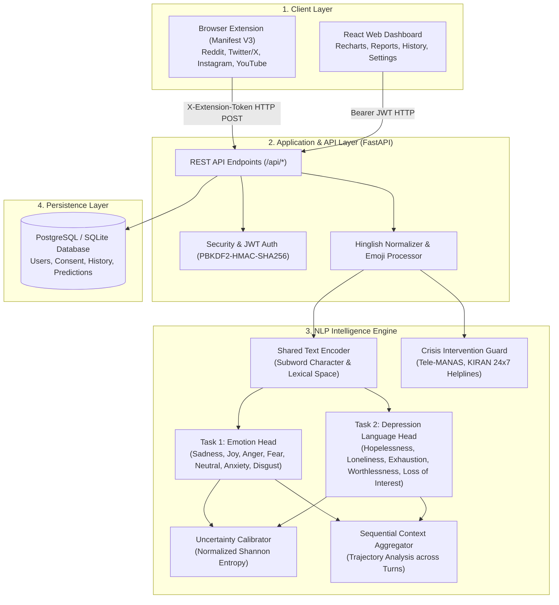

# Cognivibe AI - System Architecture Document
### A Context-Aware, Multitask AI System for Mental Health Language Analysis in Code-Mixed Social Media Content

---

## 1. System High-Level Architecture

The Cognivibe AI system consists of three interconnected layers:
1. **Client Layer:** Chrome/Edge Manifest V3 Browser Extension & Vite + React + TypeScript Dashboard.
2. **Application & Processing Layer:** FastAPI / Python Server with JWT Auth, Hinglish Normalizer, and Report Service.
3. **Machine Learning & Storage Layer:** Multitask Shared Neural Encoder, Context Aggregator, and PostgreSQL / SQLite Relational Database.

---

## 2. Multitask Model Formulation

Instead of training isolated models for emotion and depression detection, Cognivibe AI employs a **multitask learning formulation** where low-level code-mixed representations are shared across both heads:

$$\mathcal{L}_{\text{total}} = \lambda_1 \mathcal{L}_{\text{emotion}} + \lambda_2 \mathcal{L}_{\text{depression}}$$

Where:
- $\mathcal{L}_{\text{emotion}}$ is the categorical cross-entropy loss over 7 emotional categories.
- $\mathcal{L}_{\text{depression}}$ is the cross-entropy loss over specific depression indicators (loneliness, hopelessness, emotional exhaustion, negative self-perception, loss of interest, none).
- $\lambda_1 = 0.45$ and $\lambda_2 = 0.55$ balance parameter updates across the shared latent space.

---

## 3. Normalized Shannon Entropy for Model Uncertainty

To prevent overconfident predictions on ambiguous social media posts, Cognivibe calculates normalized Shannon entropy:

$$H_{\text{norm}}(P) = -\frac{\sum_{i=1}^N p_i \log_2(p_i)}{\log_2(N)}$$

- $H_{\text{norm}} \approx 0.0$: High model certainty (probabilities concentrated on one class).
- $H_{\text{norm}} > 0.85$: Ambiguous or low-signal text. Flagged as **"Inconclusive / Uncertain"** to prevent misleading the user.

---

## 4. Context-Aware Longitudinal Aggregator

Isolated sentences like *"I am so tired today"* often reflect acute physical fatigue rather than chronic depression. The Context-Aware Sequential Aggregator calculates:

$$\text{Persistence Ratio} = \frac{\sum_{t=1}^T \mathbb{I}(\text{Depression\_Flag}_t)}{T}$$

- If $\text{Persistence Ratio} \ge 0.55$ over $T \ge 2$: Trajectory classified as **Persistent Chronic Distress**.
- If $\text{Persistence Ratio} \le 0.33$ against a positive/neutral baseline: Trajectory classified as **Isolated Situational Stress**.

---

## 5. Platform Adapters

The browser extension employs modular DOM extraction adapters:
- **Reddit Adapter:** Extracts shreddit-post titles, selftext, and comment threads.
- **Twitter/X Adapter:** Extracts `article[data-testid="tweet"]` text blocks.
- **Instagram Adapter:** Extracts captions and top comments.
- **YouTube Adapter:** Extracts `ytd-comment-thread-renderer` comments.
- **Generic Selection Adapter:** Works on any highlighted text across any webpage.

